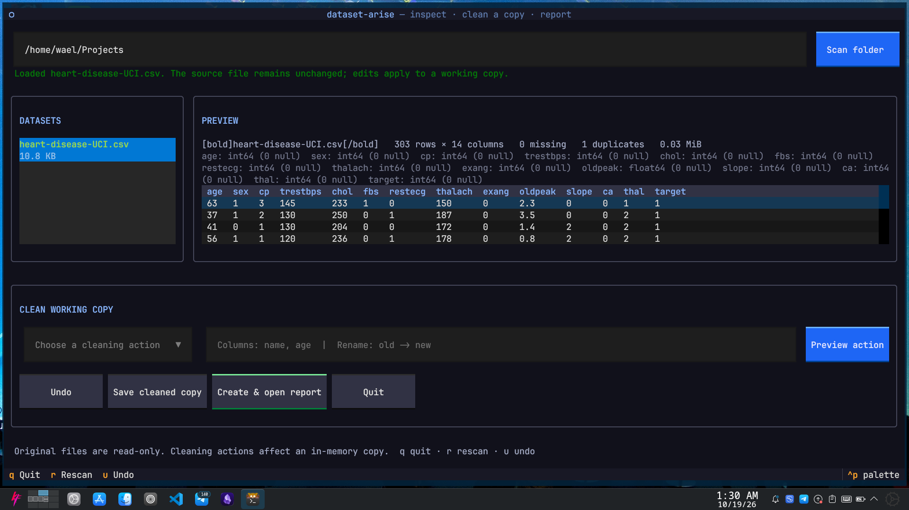
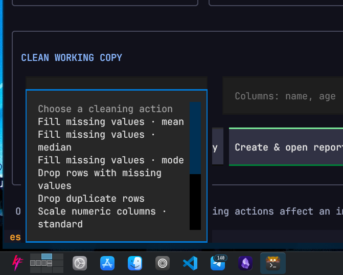
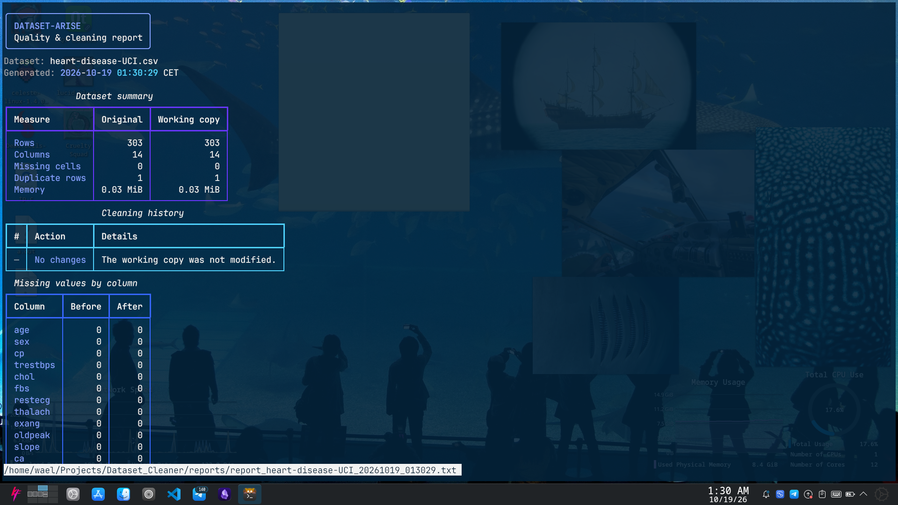

# dataset-arise

A local terminal app to inspect, clean, and report on tabular datasets. Built with Python, Textual, pandas, and Rich.

## Screenshots








## Install

```bash
git clone https://github.com/<your-username>/dataset-arise.git
cd dataset-arise
python3 -m venv .venv
source .venv/bin/activate
python -m pip install -e .
```

## Run

```bash
dataset-arise                 # Scan the current folder
dataset-arise /path/to/data   # Scan a folder you choose
```

Select a dataset to preview its rows, columns, data types, missing values, duplicates, and memory use. Choose cleaning actions from the menu; review the change before applying it. Use `q` to quit, `r` to rescan, and `u` to undo.

Supports CSV, XLSX, XLS, Parquet, and JSON. Cleaned copies go into a `cleaned/` folder beside the source; reports are saved in `reports/` and opened automatically when a terminal pager is available.

**Your source dataset is never modified.** Cleaning happens on an in-memory copy, and existing output files are not overwritten.
# Dataset-Arise
